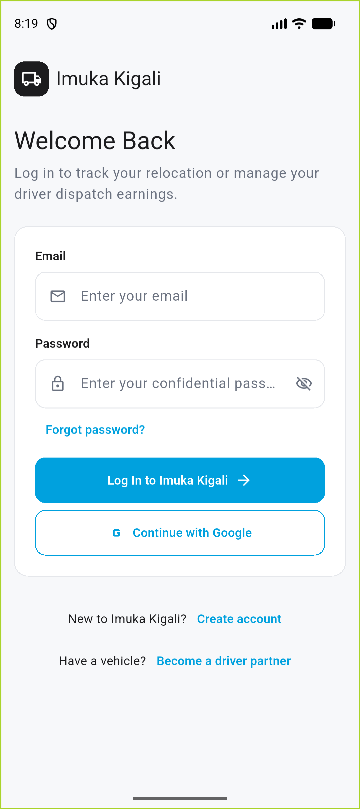
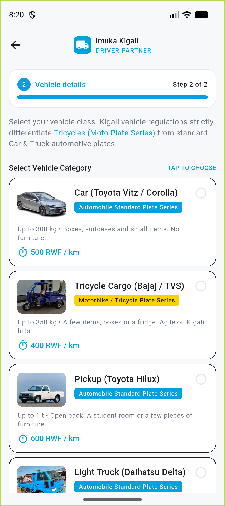
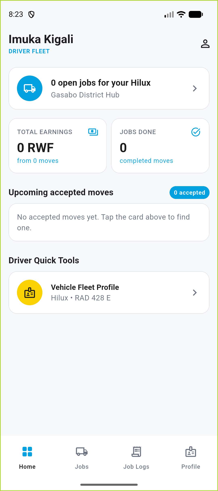

# Imuka Kigali

A moving app for Kigali, built with Flutter and Firebase.

A client picks a pickup area, a drop-off area and a vehicle type, and the app
gives a fixed price. Drivers see open jobs for their own vehicle and the first
driver to accept gets the job. Both sides then confirm the handover, the client
pays (simulated) and rates the driver.

Group 18, Mobile Application Development, African Leadership University.

Demo Video https://drive.google.com/file/d/1KGc9tmlG93kFGkzqrvZ--4DZc4Dvy83j/view?usp=drive_link 

## Screenshots

| Login | Client home | Driver registration | Driver home |
| :-: | :-: | :-: | :-: |
|  |  |  |  |

## Features

- **Sign-in:** email and password, Google sign-in, email verification,
  reset password, and a session that survives an app restart.
- **Two roles:** after login, clients and drivers land on different home screens.
- **Client:** book a move (pickup, drop-off, item, vehicle type, fixed price),
  wait live for a driver, and follow every move from the client home.
- **Driver:** two-step registration with a vehicle, a home dashboard, live open
  jobs for their vehicle type, accept a job (first driver wins), and job logs.
- **Deal:** driver contact, a handshake where both sides confirm, simulated
  payment, and a rating.
- **Settings:** theme, notifications and default district, saved on the phone.

## How the code is organised

Every screen follows the same chain:

```
Screen (draws, sends events)  ->  Bloc (decides)  ->  Repository (talks to Firebase)
```

```
lib/
  core/          theme, shared widgets, constants, validators, router
  domain/        entities and repository interfaces (no Firebase)
  data/          repository implementations (all Firebase code lives here)
  presentation/  one folder per screen: the screen and its bloc files
```

- State management: `flutter_bloc` with events. There is no `setState` in `lib/`.
- Backend: Firebase Authentication and Cloud Firestore
  (`users`, `vehicles`, `requests`, `payments`, `ratings`).
- Accepting a job and saving a payment run in Firestore transactions, so two
  drivers can't take the same job and a request can't be paid twice.

## Running the app

Requirements: Flutter 3.50 (Dart 3.14) or newer on the stable channel, the
Android SDK, and an Android emulator or phone.

```
git clone https://github.com/Abigail-Salem-Tendo/ImukaKigali.git
cd ImukaKigali
flutter pub get
flutter run
```

- The Firebase files (`lib/firebase_options.dart` and
  `android/app/google-services.json`) are in the repository, so the app
  connects to the team's Firebase project with no extra setup.
- Google sign-in on a new computer needs that computer's SHA-1 key added in
  the Firebase project settings.
- A new account must open the link in the verification email before it can
  use the app.

## Tests

```
flutter test
flutter test --coverage
flutter analyze
```

Blocs are tested with fake repositories (`test/helpers/`), so the tests never
touch Firebase.

## Team

| Member | Role |
| --- | --- |
| Mitchell Barure | Authentication and shared widgets |
| Liliane Uwase | Driver onboarding and settings |
| Abigail Salem Tendo | Client request flow and project foundation |
| Mufaro Victoria Kunze | Driver jobs and testing |
| Bonane Niyigena | Deal and completion |
